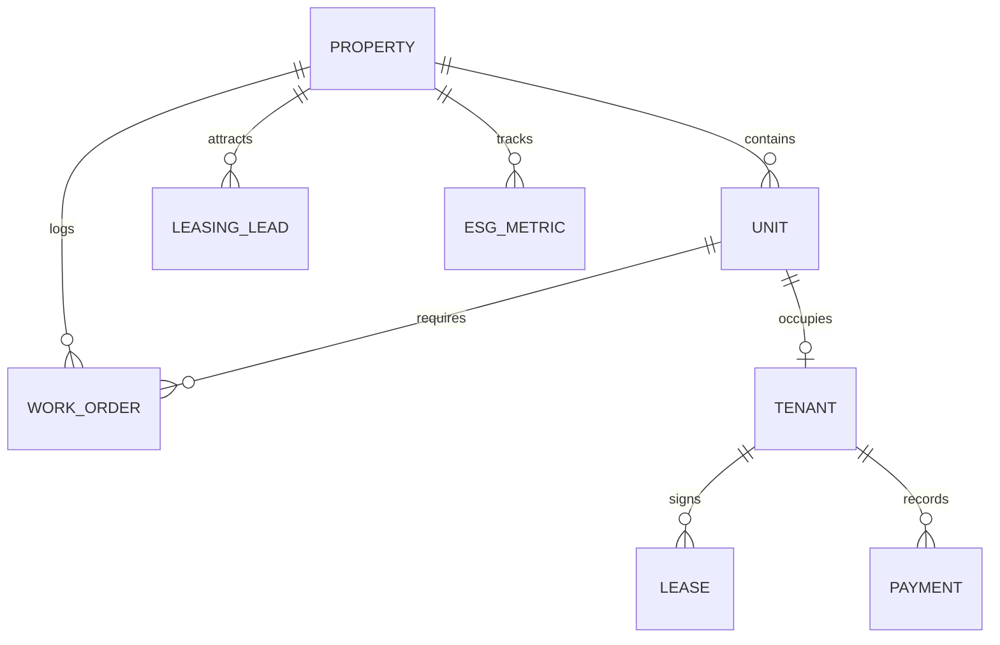
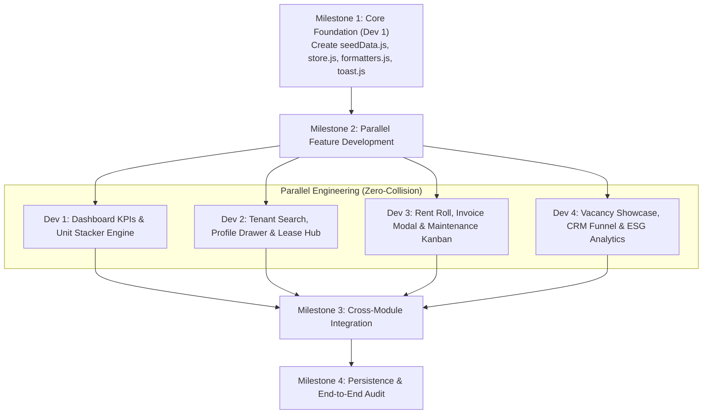

# REPMS (Real Estate Property Management System)
## 4-Developer Pure JavaScript Data Layer & Frontend Implementation Plan

> **Academic Section:** Section AB — **Project Group:** Group 15  
> **Team Members:** Shourya (Dev 1), Shikhar (Dev 2), Shatakshi (Dev 3), Shakti Dubey (Dev 4)  
> **Tech Stack Constraint:** **Strictly Pure Client-Side JavaScript (ES6+ Vanilla JS)** — Zero Node.js runtime, zero npm build steps, zero external server dependencies.  
> **Data Persistence Engine:** Browser-native `localStorage` + Centralized In-Memory Repository Store (`assets/js/core/store.js`).

---

## 📋 Table of Contents
1. [Executive Architectural Blueprint (No Node.js)](#1-executive-architectural-blueprint-no-nodejs)
2. [Data Source Architecture: Where Data Comes From](#2-data-source-architecture-where-data-comes-from)
3. [Data Access Layer: How Data is Made Available](#3-data-access-layer-how-data-is-made-available)
4. [Developer 1 Blueprint: Lead Architect, Shell & Dashboard / Portfolio](#4-developer-1-blueprint-lead-architect-shell--dashboard--portfolio)
5. [Developer 2 Blueprint: Tenant Directory & Lease Lifecycle](#5-developer-2-blueprint-tenant-directory--lease-lifecycle)
6. [Developer 3 Blueprint: Financial Operations & Maintenance Kanban](#6-developer-3-blueprint-financial-operations--maintenance-kanban)
7. [Developer 4 Blueprint: Leasing CRM & ESG Sustainability Analytics](#7-developer-4-blueprint-leasing-crm--esg-sustainability-analytics)
8. [Target JavaScript Directory & Script Inclusion Map](#8-target-javascript-directory--script-inclusion-map)
9. [Zero-Collision Team Workflow & Execution Milestones](#9-zero-collision-team-workflow--execution-milestones)

---

## 1. Executive Architectural Blueprint (No Node.js)

Because REPMS is engineered as a zero-dependency, ultra-fast client-side application, the "backend" is implemented as a **Browser-Native In-Memory & LocalStorage Data Engine**. This delivers full enterprise CRUD functionality, data persistence across page reloads, and cross-module synchronization without requiring any Node.js server, Python backend, or database setup.

```
┌────────────────────────────────────────────────────────────────────────┐
│                        USER BROWSER / DOM SHELL                        │
├─────────────────┬──────────────────┬─────────────────┬─────────────────┤
│ Dev 1 Screens   │ Dev 2 Screens    │ Dev 3 Screens   │ Dev 4 Screens   │
│ • index.html    │ • tenants.html   │ • financial.html│ • leasing.html  │
│ • portfolio.html│ • leases.html    │ • maintenance   │ • analytics.html│
│ • login.html    │                  │                 │                 │
├─────────────────┴──────────────────┴─────────────────┴─────────────────┤
│             MODULAR PAGE CONTROLLERS (ES6 / Vanilla JS)                │
│ dev1-dashboard.js  dev2-tenants.js    dev3-financial.js dev4-leasing.js  │
│ dev1-portfolio.js  dev2-leases.js     dev3-maint.js     dev4-analytics.js│
├────────────────────────────────────────────────────────────────────────┤
│                 SHARED SERVICE & UTILITY LAYER                         │
│ • assets/js/utils/formatters.js (Currency, SQFT, Date, %, Status)      │
│ • assets/js/utils/toast.js      (Bootstrap 5 toast notifications)      │
│ • assets/js/core/events.js      (CustomEvent pub/sub event bus)        │
├────────────────────────────────────────────────────────────────────────┤
│            CENTRAL DATA ACCESS ENGINE (assets/js/core/store.js)        │
│ Repository Pattern: properties, tenants, leases, financials, etc.      │
├────────────────────────────────────────────────────────────────────────┤
│                   PERSISTENCE LAYER (localStorage)                     │
│ Key: 'REPMS_DATABASE_V1' (JSON serialized state with seed fallback)    │
└────────────────────────────────────────────────────────────────────────┘
```

### Key Architectural Tenets:
1. **Zero External Server Dependency:** Anyone can double-click `index.html` or run VS Code Live Server; it works immediately in Chrome, Firefox, Edge, and Safari.
2. **Deterministic Data Seeding:** If `localStorage` is empty, `store.js` automatically bootstraps a realistic multi-asset real estate dataset.
3. **Reactive Data Mutation:** When Dev 2 adds a new tenant, Dev 3 dispatches a work order, or Dev 4 schedules a tour, the state updates in `localStorage` and triggers a custom event so cards, tables, and metric badges update synchronously.

---

## 2. Data Source Architecture: Where Data Comes From

All data originates from structured domain entities defined within `assets/js/core/seedData.js`. The state is hydrated into `localStorage` under the master key `REPMS_DATABASE_V1`.

### 2.1 Entity Relationship Diagram (ERD)



### 2.2 Domain Schemas

#### A. Properties & Unit Stack Matrix (Dev 1)
```javascript
{
  id: "PROP-001",
  name: "Skyline Executive Tower",
  assetClass: "commercial", // commercial | residential | retail | industrial | mixed-use | land
  address: "100 Financial District, New York, NY 10005",
  image: "https://images.unsplash.com/photo-1545324418-cc1a3fa10c00?w=600&h=400&fit=crop",
  totalUnits: 36,
  floorsCount: 12,
  totalSqft: 485000,
  occupancyRate: 95.8,
  capRate: 6.2,
  valuation: 285000000,
  monthlyRevenue: 1480000,
  // Detailed 12-Floor Unit Stacker Data
  floors: [
    {
      floorNumber: 12,
      floorLabel: "FL 12",
      units: [
        { unitNumber: "1201", tenant: "Apex Global Holdings", sqft: 14000, rent: 28000, status: "occupied", flex: 1 }
      ]
    },
    {
      floorNumber: 11,
      floorLabel: "FL 11",
      units: [
        { unitNumber: "1101", tenant: "VACANT AVAILABLE", sqft: 4500, rent: 18000, status: "vacant", flex: 1 },
        { unitNumber: "1102", tenant: "Starlight Capital", sqft: 5200, rent: 20800, status: "occupied", flex: 1.2 },
        { unitNumber: "1103", tenant: "Quant Edge Analytics", sqft: 4300, rent: 17200, status: "occupied", flex: 1 }
      ]
    }
    // Floors 10 down to 1...
  ]
}
```

#### B. Tenants & Payment Ledgers (Dev 2)
```javascript
{
  id: "TEN-101",
  name: "Apex Global Holdings",
  contactPerson: "Marcus Vance",
  email: "m.vance@apexglobal.com",
  phone: "+1 (212) 555-0199",
  avatar: "https://i.pravatar.cc/80?img=11",
  assetClass: "Commercial",
  propertyId: "PROP-001",
  propertyName: "Skyline Executive Tower",
  unit: "Ste 1201",
  sqft: 14000,
  monthlyRent: 28000,
  leaseStart: "2023-01-01",
  leaseEnd: "2028-12-31",
  paymentStatus: "Active", // "Active" | "Delinquent" | "Expiring"
  escrowBalance: 56000,
  emergencyContact: {
    name: "Elena Rostova (COO)",
    phone: "+1 (212) 555-0198",
    email: "e.rostova@apexglobal.com"
  },
  paymentHistory: [
    { month: "Oct 2026", amount: 28000, status: "Paid", date: "2026-10-01", method: "ACH Direct" },
    { month: "Sep 2026", amount: 28000, status: "Paid", date: "2026-09-02", method: "ACH Direct" }
  ]
}
```

#### C. Leases & Escalation Schedules (Dev 2)
```javascript
{
  id: "LSE-2023-089",
  tenantId: "TEN-101",
  tenantName: "Apex Global Holdings",
  propertyId: "PROP-001",
  propertyName: "Skyline Executive Tower",
  unit: "Ste 1201",
  stage: "active", // "draft" | "active" | "renewal" | "expired"
  startDate: "2023-01-01",
  endDate: "2028-12-31",
  baseMonthlyRent: 28000,
  securityDeposit: 56000,
  escalationType: "Annual CPI + 2.5%",
  nextEscalationDate: "2027-01-01",
  nextEscalationRate: 29400,
  clausesVerified: true,
  insuranceValidUntil: "2027-06-30"
}
```

#### D. Financial Operations, Rent Roll & Invoices (Dev 3)
```javascript
{
  summary: {
    grossRevenue: 1240000,
    totalExpenses: 382000,
    netOperatingIncome: 858000,
    collectionRate: 96.8,
    delinquentAmount: 48200
  },
  rentRoll: [
    {
      invoiceId: "INV-2026-1001",
      unit: "Ste 1201",
      property: "Skyline Tower",
      tenant: "Apex Global Holdings",
      baseRent: 28000,
      camFee: 2400,
      lateFee: 0,
      totalDue: 30400,
      status: "Paid", // "Paid" | "Pending" | "Overdue"
      paidDate: "2026-10-01",
      paymentMethod: "ACH Direct",
      remitAddress: "REPMS Escrow Trust, 100 Wall St, Suite 400, NY"
    }
  ]
}
```

#### E. Maintenance Work Orders & Vendors (Dev 3)
```javascript
{
  id: "WO-8492",
  title: "Main Chiller Compressor Vibration Alert",
  propertyId: "PROP-001",
  propertyName: "Skyline Executive Tower",
  unit: "Mechanical Penthouse",
  category: "HVAC",
  priority: "Emergency", // "Emergency" | "High" | "Normal" | "Low"
  status: "triage",      // "triage" | "dispatched" | "in_progress" | "resolved"
  reportedAt: "2026-10-31T08:30:00",
  slaHoursRemaining: 3.5,
  costCap: 5000,
  assignedVendor: {
    id: "VEN-04",
    name: "Carrier Commercial Systems",
    contact: "+1 (800) 555-0144",
    technician: "Alex Rivera"
  },
  description: "Sensor detected 8.2mm/s vibration on centrifugal chiller bearing #2."
}
```

#### F. Leasing Vacancies & Prospect CRM Pipeline (Dev 4)
```javascript
{
  vacancies: [
    {
      id: "VAC-801",
      propertyId: "PROP-001",
      propertyName: "Skyline Executive Tower",
      unit: "Ste 801",
      category: "commercial",
      sqft: 6000,
      pricePerSqft: 48,
      monthlyRent: 24000,
      floorplan: "Class-A Full Floor Shell",
      availableDate: "Immediate",
      image: "https://images.unsplash.com/photo-1497366216548-37526070297c?w=600&h=400&fit=crop"
    }
  ],
  leads: [
    {
      id: "LEAD-301",
      name: "BioGenix Diagnostics",
      contactPerson: "Dr. Rachel Adams",
      email: "r.adams@biogenix.com",
      phone: "+1 (646) 555-8910",
      targetUnit: "Ste 801",
      budget: 25000,
      incomeToRentRatio: "4.8x",
      creditScore: 785,
      stage: "tour_scheduled", // "inquiry" | "tour_scheduled" | "applied" | "screening" | "lease_sent"
      tourDate: "2026-11-04 14:00"
    }
  ]
}
```

#### G. ESG Sustainability & Asset Yields (Dev 4)
```javascript
{
  portfolioESG: {
    energyStarScore: 92,
    solarGenerationKwh: 342000,
    gridConsumptionKwh: 618000,
    carbonOffsetTons: 1840,
    waterEfficiencyScore: 89,
    leedCertifications: {
      platinum: 2,
      gold: 3,
      silver: 1
    }
  },
  yields: [
    { assetClass: "Commercial", avgCapRate: 6.2, cashYield: 8.4, occupancy: 95.8, rentSqft: 52 },
    { assetClass: "Residential", avgCapRate: 5.4, cashYield: 7.1, occupancy: 98.2, rentSqft: 46 },
    { assetClass: "Retail", avgCapRate: 7.1, cashYield: 9.2, occupancy: 88.0, rentSqft: 68 },
    { assetClass: "Industrial", avgCapRate: 6.8, cashYield: 10.1, occupancy: 100.0, rentSqft: 18 },
    { assetClass: "Mixed-Use", avgCapRate: 5.9, cashYield: 8.0, occupancy: 94.0, rentSqft: 49 },
    { assetClass: "Land", avgCapRate: 8.5, cashYield: 11.4, occupancy: 100.0, rentSqft: 8 }
  ]
}
```

---

## 3. Data Access Layer: How Data is Made Available

To ensure clean separation of concerns and zero merge conflicts, all 4 developers read from and mutate data through a unified global JavaScript store: `window.REPMS_STORE`.

### 3.1 Store Implementation (`assets/js/core/store.js`)

```javascript
// assets/js/core/store.js
(function () {
  const STORAGE_KEY = 'REPMS_DATABASE_V1';

  // 1. Initialize from localStorage or seed
  function getDatabase() {
    const raw = localStorage.getItem(STORAGE_KEY);
    if (!raw) {
      localStorage.setItem(STORAGE_KEY, JSON.stringify(window.REPMS_SEED_DATA));
      return window.REPMS_SEED_DATA;
    }
    return JSON.parse(raw);
  }

  // 2. Persist database mutation to localStorage
  function saveDatabase(db) {
    localStorage.setItem(STORAGE_KEY, JSON.stringify(db));
    // Emit global change notification
    window.dispatchEvent(new CustomEvent('repms:state-change', { detail: db }));
  }

  // 3. Public API exposed to all developers
  window.REPMS_STORE = {
    // --- DEV 1 ACCESSORS ---
    properties: {
      getAll: (filterClass = 'all') => {
        const db = getDatabase();
        if (filterClass === 'all') return db.properties;
        return db.properties.filter(p => p.assetClass.toLowerCase() === filterClass.toLowerCase());
      },
      getById: (id) => getDatabase().properties.find(p => p.id === id),
      getUnitStack: (propId) => getDatabase().unitStackerData,
      getDashboardSummary: () => getDatabase().dashboardSummary
    },

    // --- DEV 2 ACCESSORS ---
    tenants: {
      getAll: (query = '', propertyFilter = 'all', statusFilter = 'all') => {
        let list = getDatabase().tenants;
        if (propertyFilter !== 'all') list = list.filter(t => t.propertyId === propertyFilter);
        if (statusFilter !== 'all') list = list.filter(t => t.paymentStatus.toLowerCase() === statusFilter.toLowerCase());
        if (query.trim()) {
          const q = query.toLowerCase();
          list = list.filter(t => 
            t.name.toLowerCase().includes(q) || 
            t.contactPerson.toLowerCase().includes(q) ||
            t.unit.toLowerCase().includes(q)
          );
        }
        return list;
      },
      getById: (id) => getDatabase().tenants.find(t => t.id === id),
      add: (tenantData) => {
        const db = getDatabase();
        const newTenant = {
          id: 'TEN-' + (100 + db.tenants.length + 1),
          ...tenantData,
          paymentHistory: []
        };
        db.tenants.unshift(newTenant);
        saveDatabase(db);
        return newTenant;
      }
    },
    leases: {
      getAll: (stage = 'all') => {
        const list = getDatabase().leases;
        if (stage === 'all') return list;
        return list.filter(l => l.stage.toLowerCase() === stage.toLowerCase());
      },
      getEscalations: () => getDatabase().escalations,
      updateStage: (leaseId, newStage) => {
        const db = getDatabase();
        const target = db.leases.find(l => l.id === leaseId);
        if (target) {
          target.stage = newStage;
          saveDatabase(db);
        }
      }
    },

    // --- DEV 3 ACCESSORS ---
    financials: {
      getOverview: () => getDatabase().financialOverview,
      getRentRoll: (statusFilter = 'all') => {
        const list = getDatabase().rentRoll;
        if (statusFilter === 'all') return list;
        return list.filter(r => r.status.toLowerCase() === statusFilter.toLowerCase());
      },
      getInvoiceById: (invoiceId) => getDatabase().rentRoll.find(r => r.invoiceId === invoiceId)
    },
    maintenance: {
      getWorkOrders: (priorityFilter = 'all') => {
        let list = getDatabase().workOrders;
        if (priorityFilter !== 'all') {
          list = list.filter(w => w.priority.toLowerCase() === priorityFilter.toLowerCase());
        }
        return list;
      },
      updateStatus: (workOrderId, newStatus) => {
        const db = getDatabase();
        const wo = db.workOrders.find(w => w.id === workOrderId);
        if (wo) {
          wo.status = newStatus;
          saveDatabase(db);
        }
      },
      dispatchVendor: (workOrderId, vendorData) => {
        const db = getDatabase();
        const wo = db.workOrders.find(w => w.id === workOrderId);
        if (wo) {
          wo.assignedVendor = vendorData;
          wo.status = 'dispatched';
          saveDatabase(db);
        }
      },
      addWorkOrder: (orderData) => {
        const db = getDatabase();
        const newOrder = {
          id: 'WO-' + Math.floor(1000 + Math.random() * 9000),
          status: 'triage',
          reportedAt: new Date().toISOString(),
          ...orderData
        };
        db.workOrders.unshift(newOrder);
        saveDatabase(db);
        return newOrder;
      }
    },

    // --- DEV 4 ACCESSORS ---
    leasing: {
      getVacancies: (category = 'all') => {
        const list = getDatabase().vacancies;
        if (category === 'all') return list;
        return list.filter(v => v.category.toLowerCase() === category.toLowerCase());
      },
      getLeads: () => getDatabase().leads,
      updateLeadStage: (leadId, newStage) => {
        const db = getDatabase();
        const lead = db.leads.find(l => l.id === leadId);
        if (lead) {
          lead.stage = newStage;
          saveDatabase(db);
        }
      },
      addLead: (leadData) => {
        const db = getDatabase();
        const newLead = {
          id: 'LEAD-' + Math.floor(100 + Math.random() * 900),
          stage: 'inquiry',
          ...leadData
        };
        db.leads.unshift(newLead);
        saveDatabase(db);
        return newLead;
      }
    },
    analytics: {
      getESG: () => getDatabase().portfolioESG,
      getYields: () => getDatabase().yields,
      getRoadmap: () => getDatabase().sustainabilityRoadmap
    }
  };
})();
```

---

## 4. Developer 1 Blueprint: Lead Architect, Shell & Dashboard / Portfolio

> **Developer:** Shourya (Dev 1)  
> **Pages Owned:** `index.html`, `pages/portfolio.html`, `login.html`, and Global Shell Navigation  
> **Target JS Files:**
> - `assets/js/core/seedData.js` (Initial relational JSON seed data)
> - `assets/js/core/store.js` (Shared localStorage store wrapper)
> - `assets/js/modules/dev1-shell.js` (Theme toggle, auth guard, topbar search)
> - `assets/js/modules/dev1-dashboard.js` (`index.html` KPI cards, activity feed)
> - `assets/js/modules/dev1-portfolio.js` (`portfolio.html` property filters & building unit stacker)

### 4.1 Detailed Logic Breakdown for Dev 1

#### Logic 1: Executive KPI Strip & Counter Animation (`dev1-dashboard.js`)
* **Where It Runs:** In `index.html` on the 4 top KPI cards (Portfolio Value, Blended Occupancy, Net Revenue, Open Work Orders).
* **Data Origin:** `window.REPMS_STORE.properties.getDashboardSummary()`.
* **Execution Logic:**
  1. On DOMContentLoaded, query `.rep-metric-card` or respective metric IDs (`#kpiPortfolioValue`, `#kpiOccupancy`, etc.).
  2. Implement an animated number increment counter function (`animateValue(element, start, end, duration, formatter)`).
  3. Format numbers using `window.REPMS_FORMATTERS.formatCurrency` and `formatPercent`.
  4. Hydrate sub-trend text (e.g. `+4.2% MoM`).

#### Logic 2: Recent Critical Activity Feed Hydration (`dev1-dashboard.js`)
* **Where It Runs:** In `index.html` under the Urgent Alerts & Recent Activity card container.
* **Data Origin:** `getDashboardSummary().recentActivity`.
* **Execution Logic:**
  1. Clear static placeholder items.
  2. Map through activity items: format timestamp into relative time (`20 mins ago`, `1 hour ago`).
  3. Inject badge classes dynamically based on severity (`emergency` &rarr; crimson badge, `warning` &rarr; amber badge, `info` &rarr; blue badge).

#### Logic 3: Multi-Asset Class Filter Pills (`dev1-portfolio.js`)
* **Where It Runs:** In `pages/portfolio.html` filter bar: `[All | Commercial | Residential | Retail | Industrial | Land]`.
* **Data Origin:** `window.REPMS_STORE.properties.getAll(category)`.
* **Execution Logic:**
  1. Bind click listeners to all buttons matching `.rep-filter-pill`.
  2. On click, remove `.active` class from siblings, add `.active` to clicked pill.
  3. Extract `data-asset-class` attribute (`all`, `commercial`, etc.).
  4. Call `REPMS_STORE.properties.getAll(selectedClass)`.
  5. Re-render the `#propertyGrid` container with matching property cards.

#### Logic 4: Interactive Building Unit Stacker Engine (`dev1-portfolio.js`)
* **Where It Runs:** In `pages/portfolio.html` in the 12-Floor Building Elevation Visualizer (`#unitStackerContainer`).
* **Data Origin:** `window.REPMS_STORE.properties.getUnitStack('PROP-001')`.
* **Execution Logic:**
  1. Loop through floors from `floorNumber: 12` down to `floorNumber: 1`.
  2. For each floor, create `.rep-stacker__floor` with label `FL 12`, `FL 11`, etc.
  3. Inside `.rep-stacker__units`, generate `.rep-unit` elements:
     - Set flex basis/grow based on `unit.flex` or `unit.sqft`.
     - Assign modifier class: `.rep-unit--occupied` (emerald), `.rep-unit--vacant` (electric cyan), or `.rep-unit--maintenance` (amber).
     - Attach Bootstrap Tooltip attributes: `data-bs-toggle="tooltip"` and title formatted as:  
       `Ste ${unit.unitNumber}: ${unit.tenant} | ${unit.sqft.toLocaleString()} sqft | $${unit.rent.toLocaleString()}/mo`.
     - Initialize Bootstrap tooltips: `new bootstrap.Tooltip(unitEl)`.
  4. Attach click listener to each `.rep-unit`:
     - Opens `#unitDetailModal`.
     - Hydrates unit number, tenant name, monthly rent, square footage, and lease end date.

#### Logic 5: App Shell Session Guard & Theme Manager (`dev1-shell.js`)
* **Where It Runs:** Across all pages (`index.html`, `pages/*`, `dev3/*`).
* **Execution Logic:**
  1. Check `sessionStorage.getItem('REPMS_USER')`. If missing and current page is not `login.html`, redirect to `login.html`.
  2. Populate user avatar (`#topUserAvatar`) and name (`#topUserName`) from session object.
  3. Theme toggle: reads `localStorage.getItem('theme')`, sets `data-bs-theme="dark"` or `"light"`, and updates sun/moon icons.

---

## 5. Developer 2 Blueprint: Tenant Directory & Lease Lifecycle

> **Developer:** Shikhar (Dev 2)  
> **Pages Owned:** `pages/tenants.html` (Tenant Directory & Profiles), `pages/leases.html` (Lease Lifecycle Hub)  
> **Target JS Files:**
> - `assets/js/modules/dev2-tenants.js` (Tenant directory search, filters, drawer, add tenant)
> - `assets/js/modules/dev2-leases.js` (Lease pipeline stages, escalation schedule, agreement modal)

### 5.1 Detailed Logic Breakdown for Dev 2

#### Logic 1: High-Density Tenant Search & Debounced Filter (`dev2-tenants.js`)
* **Where It Runs:** In `pages/tenants.html` search input `#tenantSearchInput`, property select `#propertyFilterSelect`, and status filter `#statusFilterSelect`.
* **Data Origin:** `window.REPMS_STORE.tenants.getAll(searchQuery, propertyId, status)`.
* **Execution Logic:**
  1. Add debounced `input` event listener (300ms) to `#tenantSearchInput`.
  2. Add `change` event listeners to `#propertyFilterSelect` and `#statusFilterSelect`.
  3. On change:
     ```javascript
     const q = searchInput.value;
     const prop = propertySelect.value;
     const status = statusSelect.value;
     const filteredTenants = REPMS_STORE.tenants.getAll(q, prop, status);
     renderTenantTable(filteredTenants);
     ```
  4. Update tenant counter indicator: `"Showing X of Y active tenants"`.

#### Logic 2: Dynamic Tenant Table Rendering (`dev2-tenants.js`)
* **Where It Runs:** In `pages/tenants.html` table body `#tenantTableBody`.
* **Execution Logic:**
  1. Clear current table contents.
  2. If empty, render an elegant empty state row: `<td colspan="7">No tenants match the filter criteria.</td>`.
  3. For each tenant, generate a row with:
     - Avatar image + Tenant Name + Company.
     - Linked unit badge (e.g. `Ste 1201 — Skyline Tower`).
     - Monospace monthly rent formatted via `REPMS_FORMATTERS.formatCurrency(tenant.monthlyRent)`.
     - Lease expiration date with warning tag if `< 60 days`.
     - Payment status badge (`.rep-badge--active`, `.rep-badge--delinquent`, `.rep-badge--expiring`).
     - Action buttons: "View Profile" (`data-tenant-id="..."`), "Notice", "Edit".

#### Logic 3: Tenant Profile Offcanvas Drawer Hydration (`dev2-tenants.js`)
* **Where It Runs:** In `pages/tenants.html` offcanvas drawer `#tenantProfileDrawer`.
* **Data Origin:** `window.REPMS_STORE.tenants.getById(tenantId)`.
* **Execution Logic:**
  1. Event delegation on `#tenantTableBody`: listen for clicks on `.btn-view-tenant`.
  2. Extract `tenantId = e.target.closest('[data-tenant-id]').dataset.tenantId`.
  3. Retrieve tenant object via `REPMS_STORE.tenants.getById(tenantId)`.
  4. Populate drawer DOM fields:
     - Header: Tenant name, unit number, contact avatar.
     - Contact details: Email, phone, designated contact person.
     - Emergency contact card: Name, phone, relationship.
     - Financial terms: Monthly rent, security deposit escrow balance (`$56,000`).
     - Payment history table: iterate `tenant.paymentHistory` and render past 3 months' invoices with Paid/Pending status badges.
  5. Show offcanvas using `bootstrap.Offcanvas.getOrCreateInstance(drawerEl).show()`.

#### Logic 4: Add New Tenant Modal Form Handling (`dev2-tenants.js`)
* **Where It Runs:** In `pages/tenants.html` modal `#addTenantModal`.
* **Execution Logic:**
  1. Intercept `submit` event on form `#addTenantForm`.
  2. Validate required inputs: Company Name, Contact Email, Assigned Unit, Monthly Rent.
  3. Assemble new tenant payload and invoke `REPMS_STORE.tenants.add(payload)`.
  4. Close modal: `bootstrap.Modal.getInstance(modalEl).hide()`.
  5. Reset form inputs.
  6. Trigger `window.REPMS_TOAST.show('Tenant added successfully!', 'success')`.
  7. Re-render tenant table to immediately show the new record.

#### Logic 5: Lease Pipeline Counter Cards & Stage Filtering (`dev2-leases.js`)
* **Where It Runs:** In `pages/leases.html` top stage cards: Draft (4), Active (1,340), Renewal Review (24), Expired (12).
* **Data Origin:** `window.REPMS_STORE.leases.getAll(stage)`.
* **Execution Logic:**
  1. Query counts for each stage from `REPMS_STORE.leases` and update numeric badges `#countDraft`, `#countActive`, `#countRenewal`, `#countExpired`.
  2. Attach click handlers to stage tabs/cards.
  3. On click, filter the lease agreements table below to display only leases in the selected stage.

#### Logic 6: Rent Escalation Schedule Engine (`dev2-leases.js`)
* **Where It Runs:** In `pages/leases.html` under `#escalationScheduleTable`.
* **Data Origin:** `window.REPMS_STORE.leases.getEscalations()`.
* **Execution Logic:**
  1. Fetch scheduled escalations array.
  2. For each record, compute:
     - `rentDelta = record.newRent - record.currentRent`
     - Days until bump: `Math.ceil((new Date(record.effectiveDate) - new Date()) / (1000 * 60 * 60 * 24))`
  3. Render table row with Tenant, Unit, Current Rent, New Escalated Rent, Bump %, Effective Date, and Status Pill (`Scheduled` or `Queued`).

#### Logic 7: Interactive Lease Agreement Viewer Modal (`dev2-leases.js`)
* **Where It Runs:** In `pages/leases.html` modal `#leaseAgreementModal`.
* **Execution Logic:**
  1. On clicking "View Lease Document" in any table row:
  2. Populate mock contract text: Parties, Premises (Unit #, Property), Term (Start to End), Base Monthly Rent, Permitted Use, and Insurance Covenant.
  3. Show digital signature status (`Verified Cryptographically` or `Awaiting Signature`).

---

## 6. Developer 3 Blueprint: Financial Operations & Maintenance Kanban

> **Developer:** Shatakshi (Dev 3)  
> **Pages Owned:** `dev3/financial.html` (Financial Operations & Rent Roll), `dev3/maintenance.html` (Maintenance Kanban & SLA Tracker)  
> **Target JS Files:**
> - `assets/js/modules/dev3-financials.js` (NOI metrics, rent roll table, dynamic invoice modal, CSV export)
> - `assets/js/modules/dev3-maintenance.js` (Kanban board, drag/transition, live SLA countdown, dispatch modal)

### 6.1 Detailed Logic Breakdown for Dev 3

#### Logic 1: Net Operating Income (NOI) & KPI Metric Engine (`dev3-financials.js`)
* **Where It Runs:** In `dev3/financial.html` top financial cards (Total Revenue, Total Expenses, Net Operating Income, Rent Collection %).
* **Data Origin:** `window.REPMS_STORE.financials.getOverview()`.
* **Execution Logic:**
  1. Retrieve financial overview from store.
  2. Dynamically calculate NOI if needed: `NOI = Gross Revenue - Total Operating Expenses`.
  3. Populate `#totalRevenueText` (`$1.24M`), `#totalExpensesText` (`$382K`), `#noiText` (`$858K`), and `#collectionRateText` (`96.8%`).
  4. Recalculate collection progress bar width dynamically: `style="width: 96.8%"`.

#### Logic 2: Monthly Rent Roll Statement Table & Filtering (`dev3-financials.js`)
* **Where It Runs:** In `dev3/financial.html` rent roll statement table `#rentRollTableBody`.
* **Data Origin:** `window.REPMS_STORE.financials.getRentRoll(statusFilter)`.
* **Execution Logic:**
  1. Listen for clicks on filter tabs: `[All Statuses | Paid | Pending | Overdue]`.
  2. Filter `rentRoll` array and render rows:
     - Unit #, Property Name, Tenant Name.
     - Base Rent, CAM Fee, Late Charges, Total Due.
     - Paid Date, Payment Method (ACH, Wire, Stripe).
     - Action button: `<button class="btn btn-sm btn-outline-primary btn-generate-invoice" data-invoice-id="INV-2026-1001">Invoice</button>`.

#### Logic 3: Dynamic Printable Invoice Modal & Print Layout (`dev3-financials.js`)
* **Where It Runs:** In `dev3/financial.html` modal `#invoiceModal`.
* **Data Origin:** `window.REPMS_STORE.financials.getInvoiceById(invoiceId)`.
* **Execution Logic:**
  1. Listen for clicks on `.btn-generate-invoice`.
  2. Read `invoiceId` from button's `dataset.invoiceId`.
  3. Fetch invoice details from store.
  4. Populate Invoice Modal DOM:
     - Invoice Number (`#modalInvoiceNumber`) & Issue Date.
     - Billed To: Tenant Name, Company, Unit Number.
     - Remit To: Bank Wire Details & Escrow Address.
     - Itemized Table: Base Rent row, CAM Shared Operating Expenses row, Taxes row, and Calculated Total.
  5. Show `#invoiceModal`.
  6. Bind click on `#btnPrintInvoice` to invoke `window.print()`.

#### Logic 4: Financial CSV Report Exporter (`dev3-financials.js`)
* **Where It Runs:** In `dev3/financial.html` on button `.export-btn` ("Export Report").
* **Execution Logic:**
  1. On click, retrieve full rent roll dataset: `REPMS_STORE.financials.getRentRoll('all')`.
  2. Construct CSV string:
     ```javascript
     const headers = "Invoice ID,Unit,Property,Tenant,Base Rent,CAM Fee,Late Fee,Total Due,Status,Payment Date\n";
     const rows = list.map(r => `"${r.invoiceId}","${r.unit}","${r.property}","${r.tenant}",${r.baseRent},${r.camFee},${r.lateFee},${r.totalDue},"${r.status}","${r.paidDate}"`).join("\n");
     ```
  3. Create Blob: `new Blob([headers + rows], { type: 'text/csv;charset=utf-8;' })`.
  4. Create temporary anchor element, set `download="REPMS_Rent_Roll_Oct2026.csv"`, and programmatically trigger `.click()`.

#### Logic 5: Maintenance Work Order Kanban Pipeline (`dev3-maintenance.js`)
* **Where It Runs:** In `dev3/maintenance.html` Kanban columns:
  - Column 1: `#colTriage` (Reported / Triage)
  - Column 2: `#colDispatched` (Dispatched to Contractor)
  - Column 3: `#colInProgress` (In Progress / Parts Ordered)
  - Column 4: `#colResolved` (Resolved & Inspected)
* **Data Origin:** `window.REPMS_STORE.maintenance.getWorkOrders()`.
* **Execution Logic:**
  1. Clear existing Kanban columns.
  2. Iterate through work orders and place each card into its matching column based on `order.status`.
  3. Card elements include:
     - Ticket ID (`WO-8492`), Unit & Property.
     - Priority Badge: `Emergency` (pulsing red animation), `High`, `Normal`, `Low`.
     - Category icon: Plumbing (wrench), Electrical (lightning), HVAC (snow/wind), Elevator.
     - Assigned Contractor name or "Unassigned".
     - Live SLA badge container.
     - Quick stage advance buttons: e.g. "Dispatch" or "Mark In Progress" or "Resolve".
  4. On clicking an advance button: calls `REPMS_STORE.maintenance.updateStatus(orderId, nextStatus)`, which automatically triggers re-render.

#### Logic 6: Real-Time Live SLA Countdown Timers (`dev3-maintenance.js`)
* **Where It Runs:** In all active tickets on the Maintenance Kanban board.
* **Execution Logic:**
  1. Define a 60-second recurring timer interval (`setInterval(updateSLATimers, 60000)`).
  2. For every work order with status other than `'resolved'`:
     - Calculate remaining milliseconds: `slaDeadline - Date.now()`.
     - Convert to remaining hours and minutes: `const hours = Math.floor(diff / 3600000); const mins = Math.floor((diff % 3600000) / 60000);`.
     - If `diff <= 0`: Set SLA badge text to `SLA BREACHED` and apply crimson flashing style.
     - If `diff < 2 hours`: Apply amber urgent style.
     - Else: Display `SLA: ${hours}h ${mins}m remaining`.

#### Logic 7: Contractor Dispatch Modal Workflow (`dev3-maintenance.js`)
* **Where It Runs:** In `dev3/maintenance.html` modal `#dispatchModal`.
* **Execution Logic:**
  1. On clicking "Dispatch Vendor" on any triage card, set `currentWorkOrderId` and open `#dispatchModal`.
  2. User selects vendor from dropdown (e.g. "Carrier Commercial Systems", "Apex Master Plumbers"), enters SLA hours target (e.g. `4`), and enters maximum cost cap (e.g. `$1,500`).
  3. On form submit:
     - Call `REPMS_STORE.maintenance.dispatchVendor(currentWorkOrderId, vendorData)`.
     - Toast: `window.REPMS_TOAST.show('Contractor dispatched successfully with SLA target!', 'success')`.
     - Hide modal and re-render Kanban board.

---

## 7. Developer 4 Blueprint: Leasing CRM & ESG Sustainability Analytics

> **Developer:** Shakti Dubey (Dev 4)  
> **Pages Owned:** `pages/leasing.html` (Vacancy Showcase & CRM Funnel), `pages/analytics.html` (ESG Sustainability & Yield Analytics)  
> **Target JS Files:**
> - `assets/js/modules/dev4-leasing.js` (Vacancy filters, tour booking modal, CRM pipeline stages, add lead)
> - `assets/js/modules/dev4-analytics.js` (ESG gauges, dynamic solar vs grid bar, cap rate yield table, roadmap milestone tracker)

### 7.1 Detailed Logic Breakdown for Dev 4

#### Logic 1: Vacancy Gallery Showcase & Category Filter (`dev4-leasing.js`)
* **Where It Runs:** In `pages/leasing.html` top category filter pills and vacancy cards grid `#vacancyGrid`.
* **Data Origin:** `window.REPMS_STORE.leasing.getVacancies(category)`.
* **Execution Logic:**
  1. Listen for click on filter buttons `.rep-filter-btn` (`All`, `Commercial`, `Residential`, `Retail`, `Industrial`).
  2. Extract selected category (`data-category`).
  3. Query store: `const units = REPMS_STORE.leasing.getVacancies(category)`.
  4. Render vacancy cards:
     - Property photo + asset category badge.
     - Unit name (`Ste 801`), Property name (`Skyline Executive Tower`).
     - SQFT (`6,000 sq ft`), Rate per sqft (`$48/sqft/yr`), Total monthly rent (`$24,000/mo`).
     - "Schedule Tour" button (`data-unit-id="VAC-801"`).

#### Logic 2: Schedule Tour Modal Integration (`dev4-leasing.js`)
* **Where It Runs:** In `pages/leasing.html` modal `#scheduleTourModal`.
* **Execution Logic:**
  1. On clicking "Schedule Tour" on any vacancy card, prefill `#tourUnitInput` with target unit name.
  2. Handle submit on `#scheduleTourForm`:
     - Extract prospect name, email, phone, and preferred date/time.
     - Call `REPMS_STORE.leasing.addLead({ name: prospectName, targetUnit: unitName, stage: 'tour_scheduled', tourDate: date })`.
     - Hide modal: `bootstrap.Modal.getInstance(modalEl).hide()`.
     - Trigger toast: `window.REPMS_TOAST.show('Tour confirmed! Added to CRM pipeline.', 'success')`.
     - Re-render CRM Pipeline to display the newly scheduled tour lead immediately.

#### Logic 3: Prospective Tenant CRM Funnel Pipeline (`dev4-leasing.js`)
* **Where It Runs:** In `pages/leasing.html` 5-column CRM Funnel Board:
  - Col 1: *New Inquiry*
  - Col 2: *Tour Scheduled*
  - Col 3: *Application Submitted*
  - Col 4: *Credit & Background Check*
  - Col 5: *Lease Sent*
* **Data Origin:** `window.REPMS_STORE.leasing.getLeads()`.
* **Execution Logic:**
  1. Retrieve all leads from store.
  2. Group leads by `lead.stage`.
  3. Render prospect cards in corresponding columns:
     - Applicant Name & Company.
     - Target Unit & Budget.
     - Financial qualification badges: Income-to-rent ratio (e.g. `4.8x`), Credit score badge (`785` in green).
     - Action buttons: "Advance Stage" (advances to next funnel column) or "Reject".
  4. When stage changes: invoke `REPMS_STORE.leasing.updateLeadStage(leadId, nextStage)` and re-render board.

#### Logic 4: Executive ESG Sustainability Gauges & Data Binding (`dev4-analytics.js`)
* **Where It Runs:** In `pages/analytics.html` ESG Scorecard strip (Energy Star Score, Solar Generation, Carbon Offset, Water Efficiency).
* **Data Origin:** `window.REPMS_STORE.analytics.getESG()`.
* **Execution Logic:**
  1. On page load, retrieve `portfolioESG` object.
  2. Animate Energy Star gauge counter from `0` to `92` (`#energyStarValue`).
  3. Compute solar proportion: `solarRatio = (solarKwh / (solarKwh + gridKwh)) * 100`.
  4. Dynamically adjust solar progress bar width: `style="width: ${solarRatio.toFixed(1)}%"`.
  5. Format Carbon Offset into metric tons (`1,840 MT CO2e`) via `REPMS_FORMATTERS`.
  6. Hydrate LEED certification badges: Platinum (2), Gold (3), Silver (1).

#### Logic 5: Multi-Asset Yield Comparative Analysis Table (`dev4-analytics.js`)
* **Where It Runs:** In `pages/analytics.html` table `#assetYieldTableBody`.
* **Data Origin:** `window.REPMS_STORE.analytics.getYields()`.
* **Execution Logic:**
  1. Retrieve multi-asset yield records.
  2. Render table rows: Asset Class, Average Cap Rate %, Cash-on-Cash Return %, Blended Occupancy %, and Average Rent/SQFT.
  3. Add table column sorting: allow clicking table headers ("Cap Rate", "Occupancy") to sort ascending or descending.

#### Logic 6: Interactive Net-Zero Roadmap Milestone Tracker (`dev4-analytics.js`)
* **Where It Runs:** In `pages/analytics.html` vertical timeline `#sustainabilityTimeline`.
* **Data Origin:** `window.REPMS_STORE.analytics.getRoadmap()`.
* **Execution Logic:**
  1. Fetch roadmap milestones (2026 Energy Audit, 2027 Solar Canopy, 2028 IoT Chiller, 2030 Net-Zero).
  2. Populate milestone status icons: `.rep-timeline-icon--completed` (green check), `.rep-timeline-icon--in-progress` (amber spinner), `.rep-timeline-icon--pending` (gray flag).
  3. Clicking any milestone card toggles an expanded detail description panel with emission targets.

---

## 8. Target JavaScript Directory & Script Inclusion Map

To maintain complete modularity with zero git merge conflicts, the codebase will adhere to the following directory structure:

### 8.1 Repository Folder Layout
```
Mini project 2 REPMS/
├── index.html                           # Dev 1 (Dashboard)
├── login.html                           # Dev 1 (Auth)
├── pages/
│   ├── portfolio.html                   # Dev 1 (Portfolio & Stacker)
│   ├── tenants.html                     # Dev 2 (Tenants)
│   ├── leases.html                      # Dev 2 (Leases)
│   ├── leasing.html                     # Dev 4 (Leasing CRM)
│   └── analytics.html                   # Dev 4 (ESG Analytics)
├── dev3/
│   ├── financial.html                   # Dev 3 (Financials)
│   └── maintenance.html                 # Dev 3 (Maintenance)
└── assets/
    └── js/
        ├── core/
        │   ├── seedData.js              # Initial multi-asset mock JSON fixtures (Dev 1 Lead)
        │   └── store.js                 # Unified localStorage Data Store & API (Shared/Dev 1)
        ├── utils/
        │   ├── formatters.js            # Currency, %, Date, SQFT formatters (Shared)
        │   └── toast.js                 # Bootstrap 5 toast notification system (Shared)
        └── modules/
            ├── dev1-shell.js            # Shell auth guard, theme toggle, search (Dev 1)
            ├── dev1-dashboard.js        # Executive Dashboard cards & activity (Dev 1)
            ├── dev1-portfolio.js        # Asset filters & 12-Floor Unit Stacker (Dev 1)
            ├── dev2-tenants.js          # Tenant directory, search, drawer, add modal (Dev 2)
            ├── dev2-leases.js           # Lease pipeline, escalations, agreement modal (Dev 2)
            ├── dev3-financials.js       # NOI calculations, rent roll, invoice modal (Dev 3)
            ├── dev3-maintenance.js      # Kanban board, live SLA timers, dispatch modal (Dev 3)
            ├── dev4-leasing.js          # Vacancy gallery, tour modal, CRM pipeline (Dev 4)
            └── dev4-analytics.js        # ESG scorecard, solar gauges, yield table (Dev 4)
```

### 8.2 Standard `<script>` Loading Order by Page

Every HTML page loads dependencies in strict layered order before the closing `</body>` tag:

| Page | Script 1 (Bootstrap) | Script 2 (Core Store) | Script 3 (Utils) | Script 4 (Dev Module) |
| :--- | :--- | :--- | :--- | :--- |
| `index.html` | `bootstrap.bundle.min.js` | `seedData.js`, `store.js` | `formatters.js`, `toast.js` | `dev1-shell.js`, `dev1-dashboard.js` |
| `pages/portfolio.html` | `bootstrap.bundle.min.js` | `seedData.js`, `store.js` | `formatters.js`, `toast.js` | `dev1-shell.js`, `dev1-portfolio.js` |
| `pages/tenants.html` | `bootstrap.bundle.min.js` | `seedData.js`, `store.js` | `formatters.js`, `toast.js` | `dev1-shell.js`, `dev2-tenants.js` |
| `pages/leases.html` | `bootstrap.bundle.min.js` | `seedData.js`, `store.js` | `formatters.js`, `toast.js` | `dev1-shell.js`, `dev2-leases.js` |
| `dev3/financial.html` | `bootstrap.bundle.min.js` | `seedData.js`, `store.js` | `formatters.js`, `toast.js` | `dev1-shell.js`, `dev3-financials.js` |
| `dev3/maintenance.html` | `bootstrap.bundle.min.js` | `seedData.js`, `store.js` | `formatters.js`, `toast.js` | `dev1-shell.js`, `dev3-maintenance.js` |
| `pages/leasing.html` | `bootstrap.bundle.min.js` | `seedData.js`, `store.js` | `formatters.js`, `toast.js` | `dev1-shell.js`, `dev4-leasing.js` |
| `pages/analytics.html` | `bootstrap.bundle.min.js` | `seedData.js`, `store.js` | `formatters.js`, `toast.js` | `dev1-shell.js`, `dev4-analytics.js` |
| `login.html` | `bootstrap.bundle.min.js` | `seedData.js`, `store.js` | `toast.js` | `dev1-shell.js` |

---

## 9. Zero-Collision Team Workflow & Execution Milestones

### 9.1 Zero-Collision Rules
1. **Isolated Module Files:** Each developer works strictly inside their assigned file in `assets/js/modules/` (e.g. `dev2-tenants.js`). No developer ever modifies another developer's module file.
2. **Central Store Mutations:** All data mutations must go through the functions defined in `window.REPMS_STORE`. Never modify `localStorage` directly inside page scripts.
3. **Scoped DOM IDs & Event Listeners:** Component IDs must be prefixed with their domain (e.g., `#tenantSearchInput`, `#invoiceModal`, `#dispatchModal`, `#tourUnitInput`).
4. **Git Branching Strategy:**
   - Dev 1: `feature/dev1-shell-dashboard`
   - Dev 2: `feature/dev2-tenants-leases`
   - Dev 3: `feature/dev3-financials-maintenance`
   - Dev 4: `feature/dev4-leasing-analytics`

### 9.2 Step-by-Step Execution Milestones



| Phase | Duration | Deliverables & Verification Criteria | Lead |
| :--- | :--- | :--- | :--- |
| **Milestone 1** | Sprint Day 1 | Establish `assets/js/core/seedData.js`, `assets/js/core/store.js`, and `assets/js/utils/`. Verify `localStorage` bootstrap in console. | Dev 1 |
| **Milestone 2** | Sprint Days 2–3 | Concurrent feature wiring: Dev 1 (Stacker), Dev 2 (Tenants/Leases), Dev 3 (Rent Roll/Kanban), Dev 4 (CRM/ESG). | All 4 Devs |
| **Milestone 3** | Sprint Day 4 | Cross-module event testing: Adding a tenant reflects in Dashboard count; dispatching work order updates SLA counter. | All 4 Devs |
| **Milestone 4** | Sprint Day 5 | Complete persistence verification: Refresh page, restart browser, verify all added records persist intact in `localStorage`. | Dev 1 (Review) |

---
*REPMS Project Group 15 — Section AB — Real Estate Property Management System*

